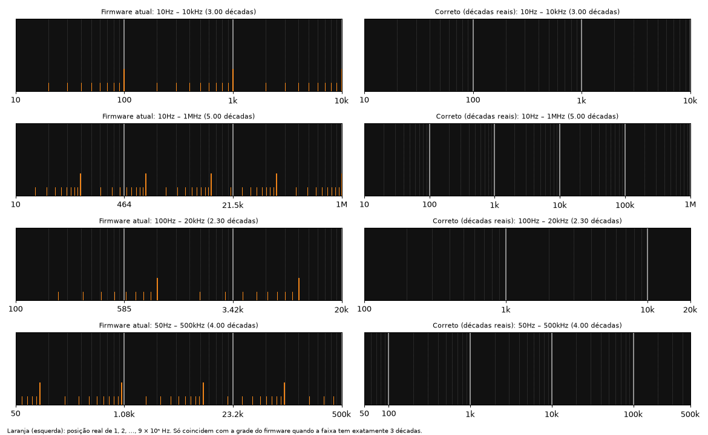

# FRA / Bode plot: frequency axis is fixed to 3 decades

Firmware 2025-06-19. Users report that the Bode plot's "log cycles are screwy" and ask for "more log
cycles". The cause is in the grid/label routine, not in the sweep.

## What the firmware does

Plot struct `S = 0x42e180c8`. Grid and labels are drawn by `sub_40038388`:

1. **Major lines:** `S[0x0a]` divisions, `S[0x08]` px apart (loop at `0x40038460`).
   `S[0x0a]` is set to **3** at factory init (`0x4003e9fc`, inside `sub_4003e738`) and never changes.
2. **Minor lines:** inside every division at `log10(2) … log10(9)` of the division width
   (loop at `0x400384b0`, `log10` = `0x4005dad0`). This assumes **each division is exactly one decade**.
3. **Labels:** always 4 (`cmp r8, #4` at `0x40038768`), value
   `10^(a + k*(b - a)/S[0x0a])`, `k = 0..3` (`pow` = `0x4005d4a4`), where
   `a = log10(f_start)`, `b = log10(f_stop)` are doubles at `S+0x8d08` / `S+0x8d10`.

`a` and `b` are computed in `sub_4003a314` (`0x4003a398..0x4003a3d0`) from the integer start/stop
frequencies at `S+0x54` / `S+0x58`. The sweep itself is a correct log sweep:
`f_k = 10^(a + k*(b - a)/points)`, points at `S+0x5c` (clamped 20..500).

## Effect

The grid is only right when the span is exactly 3 decades:

| Span | Labels shown | Minor lines |
|---|---|---|
| 10 Hz – 10 kHz (3.00 dec) | 10, 100, 1k, 10k | correct |
| 10 Hz – 1 MHz (5.00 dec) | 10, 464, 21.5k, 1M | wrong |
| 100 Hz – 20 kHz (2.30 dec) | 100, 585, 3.42k, 20k | wrong |
| 50 Hz – 500 kHz (4.00 dec) | 50, 1.08k, 23.2k, 500k | wrong |

The trace and the 4 label values are numerically correct at their positions. The misleading parts
are the minor lines, which do not fall on 2..9 × 10ⁿ, and the absence of lines at the real decades.

## Proposed fix

Build the axis from the real decades of `[f_start, f_stop]`:

- major lines at every `10^n` inside the span, `x = x0 + (n - a)/(b - a) * W`
- minor lines at `m * 10^n`, m = 2..9, inside the span
- labels at the decade lines, plus start/stop when they are not on a decade

A reference implementation (Python, used to draw the figure) is in
`tools/wav/bode_axis_reference.py`. In the binary the change is confined to the two loops above
(`0x400384b0..0x40038524` and `0x400386ec..0x4003876c`). The new code is larger than the old one,
so it needs a code cave plus a branch.

Not checked yet: the reported 180° phase error.
